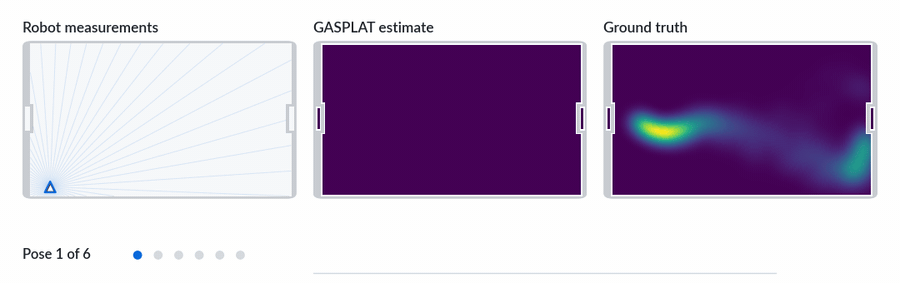
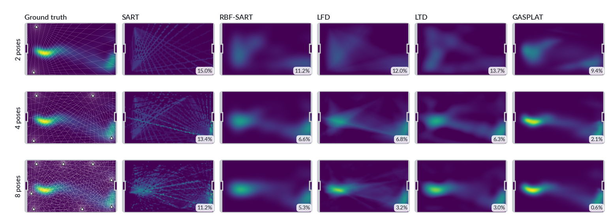
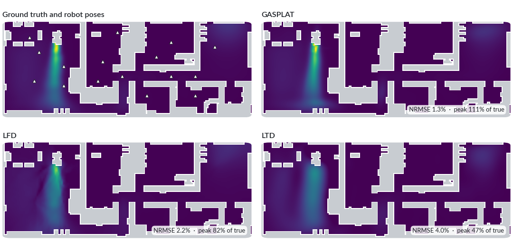

<h1 align="center">GASPLAT</h1>

<p align="center">
  <b>Gas distribution mapping from TDLAS beam integrals with 2D Gaussian primitives</b>
</p>

<p align="center">
  Alejandro Valencia-Rojas · Pepe Ojeda · Javier Monroy · Javier Gonzalez-Jimenez<br>
  <sub>Machine Perception and Intelligent Robotics (MAPIR) Group, University of Malaga</sub>
</p>

<p align="center">
  
  
  
  
</p>

<p align="center">
  <a href="#installation">Installation</a> ·
  <a href="#quick-start">Quick start</a> ·
  <a href="#data">Data</a> ·
  <a href="#experiments">Experiments</a> ·
  <a href="#citation">Citation</a>
</p>

<p align="center">
  <picture>
    <source media="(prefers-color-scheme: dark)" srcset="assets/gasplat_training_dark.gif">
    
  </picture>
</p>
<p align="center"><i>A gas plume in an empty room, mapped while the robot measures from one vantage pose after another. Each pose adds a fan of laser beams and the estimate is refined from where it was. Each ellipse is one Gaussian primitive.</i></p>

## 📖 Overview

An open-path gas sensor such as a **TDLAS** (Tunable Diode Laser Absorption Spectroscopy) does not measure the concentration at a point: each laser beam returns the **integral of the concentration along its path**. Building a gas map from these readings is a tomography problem, usually solved on a fixed grid with a smoothness prior, which fixes the resolution beforehand, flattens sharp concentration peaks and spreads gas beyond what the beams observe.

**GASPLAT** borrows the idea of [Gaussian Splatting](https://repo-sam.inria.fr/fungraph/3d-gaussian-splatting/) and represents the gas field as a mixture of **anisotropic 2D Gaussians**. The integral of a Gaussian along a straight beam has a closed form, so the predicted reading of every beam is exact and differentiable, and the primitives are fitted directly to the measurements by gradient descent.

### ✨ Highlights

- **Closed-form beam integrals**: an exact, differentiable forward model for path-integrated measurements, evaluated only for the beam–primitive pairs within three standard deviations.
- **Adaptive density**: primitives are split where the measurements ask for more detail, and new ones are injected where the beams reveal gas that no primitive explains.
- **Obstacle-aware**: a penalty built from distance fields of the map keeps the primitives out of walls and furniture.
- **Continuous map**: the result can be evaluated at any resolution, without solving again.
- **Scale-free hyperparameters**: nothing depends on the absolute concentration level or the size of the environment, so the same values serve an empty room and furnished houses.
- **Incremental**: new batches of measurements, e.g. from a new robot pose, refine the current model.

### 🔍 Compared with grid methods

<p align="center">
  <picture>
    <source media="(prefers-color-scheme: dark)" srcset="assets/room_comparison_dark.png">
    
  </picture>
</p>
<p align="center"><i>The same room with 2, 4 and 8 poses; the number in each map is its NRMSE. SART leaves streaks along the beams and the smoothness priors of LFD and LTD blur the plume, while GASPLAT recovers its shape from four poses.</i></p>

<p align="center">
  <picture>
    <source media="(prefers-color-scheme: dark)" srcset="assets/house_comparison_dark.png">
    
  </picture>
</p>
<p align="center"><i>One run in a furnished house of the VGR dataset, with the robot at random poses. LFD and LTD flatten the peak of the plume.</i></p>

<a id="installation"></a>

## 🛠️ Installation

**1. Clone the repository**
```bash
git clone https://github.com/aleevr04/gas_splatting.git
cd gas_splatting
```

**2. Create and activate a virtual environment** (any tool works; `venv` shown)
```bash
python3 -m venv .venv
source .venv/bin/activate        # Windows: .venv\Scripts\activate
```

**3. Install PyTorch** following the [official instructions](https://pytorch.org/get-started/locally/) for your hardware. GASPLAT runs on the CPU by default, which is faster than a GPU for maps of this size:
```bash
pip install torch --index-url https://download.pytorch.org/whl/cpu
```

**4. Install the dependencies**
```bash
pip install -r requirements.txt
```

<details>
<summary><b>Optional: GADEN Python bindings</b> (only to simulate new environments)</summary>

<br>

New gas simulations are run with [gaden_core](https://github.com/MAPIRlab/gaden_core), the core library of the [GADEN](https://github.com/MAPIRlab/gaden) simulator, through its Python bindings. Build it outside this repository with the virtual environment active:

```bash
git clone https://github.com/MAPIRlab/gaden_core.git ~/gaden_core && cd ~/gaden_core
git -c url."https://github.com/".insteadOf="git@github.com:" submodule update --init --recursive
sudo apt install libfmt-dev libclang-dev llvm
pip install wheel cppyy libclang
# Enable the bindings: set(GENERATE_PYTHON_BINDINGS ON) in CMakeLists.txt
mkdir build && cd build
cmake .. -DLibClang_LIBRARY=$VIRTUAL_ENV/lib/python3.10/site-packages/clang/native/libclang.so -DBSC_ENABLE_CUDA=OFF
make -j
echo ~/gaden_core/build > $VIRTUAL_ENV/lib/python3.10/site-packages/gaden_core.pth
python -c "from gaden_py import gaden"          # check
```

See the README of gaden_core for details. The VGR houses below do not need it.
</details>

<a id="quick-start"></a>

## 🚀 Quick start

```bash
# A procedural gas map, no data needed: simulates the beams, fits GASPLAT and plots the result
python main.py

# A scenario package (see below), with a live view of the training
python main.py --scenario data/scenarios/<package> --live_vis

# The same scenario, with the robot at random poses instead of the coverage planner's
python main.py --scenario data/scenarios/<package> --random_poses --seed 3
```

Every option of the simulation, the training and the densification can be set from the command line; `python main.py --help` lists them. Plots go to `plots/` and results to `results/`.

<a id="data"></a>

## 🏠 Scenario packages

Experiments run on **scenario packages**: one snapshot of a 3D gas simulation, sliced at the height of the sensor, stored in `data/scenarios/<name>/` as

| File | Contents |
| :--- | :--- |
| `scenario.npz` | ground-truth concentration (0.1 m cells), a 4× finer copy used to simulate the beams, occupancy map |
| `meta.json` | source, cell size, map size, simulation, snapshot time, height |
| `preview.png` | quick look at the gas and the obstacles |

### From the VGR dataset

The [VGR dataset](https://zenodo.org/records/10842409) ([paper](https://link.springer.com/article/10.1007/s10846-023-02012-z)) provides GADEN gas simulations in 30 furnished houses, several per house.

1. Download `GADEN_files.zip` (about 49 GB) from [Zenodo](https://zenodo.org/records/10842409) and unpack it. The houses come as `scenarios/HouseNN.zip`; they are read directly from the zips.
2. Extract the packages of the 16 simulations used here:
   ```bash
   python scripts/tools/make_scenarios.py --vgr_dir ~/GADEN_files/scenarios --set all
   ```
   `--set tuning` or `--set held_out` extract half of them, and `--iteration N` an earlier snapshot of each simulation (one every 0.5 s; the last, 1999, by default). The simulations of each set are listed in `utils/scenario_sets.py`.

### From your own GADEN simulations

With the [GADEN bindings](#installation) installed, `simulate_gaden.py` runs a simulation and writes its package. The environment is a GADEN scenario folder (e.g. `test_env/scenarios/10x6_empty_room` of the GADEN repository), and the simulation a folder with its `sim.yaml`, such as the ones in `gaden_sims/`:

```bash
python scripts/tools/simulate_gaden.py <gaden>/test_env/scenarios/10x6_empty_room \
    --sim_dir gaden_sims/10x6_empty_room/side_plume --time 1000 --height source
```

`--time` takes one or more snapshot times (s), each written as its own package, and `--height` the height of the beam plane above the floor (m), or `source` for the layer of the gas source. The simulation of the example, `gaden_sims/10x6_empty_room/side_plume/sim.yaml`:

```yaml
source:
  sourceType: point
  position: [1.0, 3.0, 0.75]
  gasType: 0
deltaTime: 0.1
windIterationDeltaTime: 1
temperature: 298
pressure: 1
filamentPPMcenter: 20
filamentInitialSigma: 30
filamentGrowthGamma: 10
filamentNoise_std: 0.02
numFilaments_sec: 100
expectedNumIterations: 10001
saveResults: false
saveDeltaTime: 0.5
preCalculateConcentrations: false
windLooping:
  loop: false
  from: 0
  to: 0
```

### Procedural maps

Smooth random gas fields without obstacles, generated on the fly: `--seeds 0 1 2` or `--set procedural` in `main.py` (`--seed`), `num_measurements.py` and the tools. The house and noise experiments need scenario packages.

<a id="experiments"></a>

## 🧪 Running the experiments

Each experiment script prints a summary and writes its results to `results/` as JSON; a separate script draws its figure from those results into `plots/`. Experiments run one reconstruction at a time by default (`--workers 1`), so that the reported times are meaningful; more workers finish sooner, with only indicative times.

**Accuracy against the number of measurements**: every method in an empty room, from 2 to 16 robot poses (a few minutes).
```bash
python scripts/experiments/num_measurements.py --scenario data/scenarios/10x6_empty_room_side_plume_h0.75_t1000 \
    --poses 2 3 4 6 8 12 16 --runs 5
python scripts/figures/num_measurements_figure.py results/num_measurements_<...>.json
```

**Comparison in furnished houses**: every method in the 16 VGR houses, each over 100 random placements of the robot's poses, with the error split by how the poses observe the free space (about 3 h with one worker; an interrupted run resumes when the command is repeated).
```bash
python scripts/experiments/random_poses.py --set all --runs 100
python scripts/figures/houses_figure.py
```

**Robustness to sensor noise**: Gaussian noise proportional to each reading, from 0 to 20 %; `--discrepancy` adds GASPLAT with its noise-aware stopping criterion.
```bash
python scripts/experiments/noise_sensitivity.py --scenario data/scenarios/10x6_empty_room_side_plume_h0.75_t1000 \
    --poses 4 8 --noise_levels 0 1 2 5 10 20 --runs 20 --discrepancy
python scripts/figures/noise_figure.py results/noise_sensitivity_<...>.json --nrmse_only --noise_aware_only
```

The baselines are SART, RBF-SART and regularized least squares with first- and third-derivative priors (LFD, LTD), all on a 0.1 m grid (`methods/`). The scripts share how cases are chosen (`--set`, `--scenario`, `--seeds`, `--iteration`), the number of runs (`--runs`, seeds 0 … N−1) and the methods (`--methods`).

<details>
<summary><b>Figures of the method</b></summary>

<br>

| Script | Shows |
| :--- | :--- |
| `scripts/figures/injection_figure.py` | the Gaussian injection, step by step |
| `scripts/figures/obstacle_figure.py` | the obstacle penalty in a two-room environment |
| `scripts/figures/distance_fields_figure.py` | the distance fields behind the obstacle penalty |

Every figure script takes `--copy_to <folder>` to copy the PDF elsewhere.
</details>

<details>
<summary><b>Tools and checks</b></summary>

<br>

| Script | Purpose |
| :--- | :--- |
| `scripts/tools/benchmark.py` | GASPLAT on a set, with NRMSE, peak, mass, gas inside walls, primitives and time per case; run it after any change |
| `scripts/tools/sweep.py` | one-at-a-time hyperparameter sweep, resumable |
| `scripts/tools/scale_invariance.py` | checks that results do not depend on the absolute concentration level |
| `scripts/tools/quick_compare.py` | every method on one case, side by side |
| `scripts/tools/profile_step.py` | time spent in each part of a training step |
| `scripts/tools/far_field_gradient.py` | why primitives far from unexplained gas need injection |
| `scripts/tools/densification_training.py` | training with the 3DGS densification vs. the mass-conserving split |
| `scripts/tools/split_c_factor.py` | the error of the split against the offset of its children |
| `scripts/tools/readme_assets.py` | the animation and comparison images of this README (light and dark variants) |
| `python -m unittest discover -s tests -t .` | unit tests of the closed-form integral |
| `visualization/live_visualizer.py` | the live training view (`--live_vis`) |
| `visualization/split_visualizer.py` | interactive tool to inspect how a primitive is split |

Hyperparameters can be explored with `sweep.py` on the `tuning` set and checked with `benchmark.py` on `held_out`, e.g.
```bash
python scripts/tools/benchmark.py --set tuning
python scripts/tools/sweep.py --params gradient_threshold --values 0.01 0.02 0.04 0.08 0.16
```
</details>

## 🗂️ Repository structure

```text
gas_splatting/
├── main.py              # Single run: simulate → initialize → train → plot
├── config.py            # Configuration (simple_parsing): simulation, training, densification
├── gs_model.py          # Gaussian mixture, rendering and density control
├── trainer.py           # Optimization loop, early stopping, injection
├── methods/             # Baselines (SART, RBF-SART, LFD, LTD) and the method registry
├── utils/               # Forward model, simulation, GADEN/VGR packages, metrics, figure style, CLI
├── scripts/
│   ├── experiments/     # The experiments of the paper
│   ├── figures/         # The figures of the paper
│   └── tools/           # Everything else: data preparation, benchmarks, sweeps, checks, method studies
├── gaden_sims/          # GADEN simulation definitions (sim.yaml) for custom scenarios
├── visualization/       # Live training view and the split visualizer
└── tests/               # Unit tests
```

<details>
<summary><b>⚙️ Configuration</b></summary>

<br>

All options live in `config.py` and are shared by every script; `python <script> --help` lists the ones a script accepts, with their defaults. They are grouped as

- **environment and simulation**: map and cell size, scenario package, number and placement of poses (`--num_poses`, `--random_poses`), angular step of the sweep, noise (`--noise`, `--noise_model`, `--noise_level`);
- **training**: learning rates, iterations, early stopping, obstacle penalty weight (`--obstacle_lambda`), known noise level for the noise-aware stop (`--known_noise_level`);
- **densification**: split and prune thresholds, injection.

Scripts that fix an option themselves (e.g. the seed of each run) reject it with an explanation instead of silently overriding it.
</details>

<a id="citation"></a>

## 📝 Citation

The paper describing GASPLAT is in preparation; a BibTeX entry will be added here once it is published.

If you use the VGR houses or GADEN, please also cite them:

- P. Ojeda, J. Monroy, J. Gonzalez-Jimenez. *VGR Dataset: A CFD-based Gas Dispersion Dataset for Mobile Robotic Olfaction.* Journal of Intelligent & Robotic Systems, 2023. [doi:10.1007/s10846-023-02012-z](https://doi.org/10.1007/s10846-023-02012-z)
- J. Monroy, V. Hernandez-Bennetts, H. Fan, A. Lilienthal, J. Gonzalez-Jimenez. *GADEN: A 3D Gas Dispersion Simulator for Mobile Robot Olfaction in Realistic Environments.* Sensors 17(7):1479, 2017.

## 🙏 Acknowledgements and license

This work was partially funded by the University of Málaga under project PPRO-TEP960-G-2023 (TEP960-G-FEDER).

The core architecture and some utilities build upon [R²-Gaussian](https://github.com/ruyi-zha/r2_gaussian), itself derived from the original [3D Gaussian Splatting](https://github.com/graphdeco-inria/gaussian-splatting) implementation by Inria and MPII. As derivative work, this repository is distributed under the same **Gaussian-Splatting License**:

- the software is provided for **non-commercial research and evaluation** only;
- commercial use requires prior consent from the original licensors (Inria/MPII).

See [`LICENSE.md`](LICENSE.md) for the full terms.
