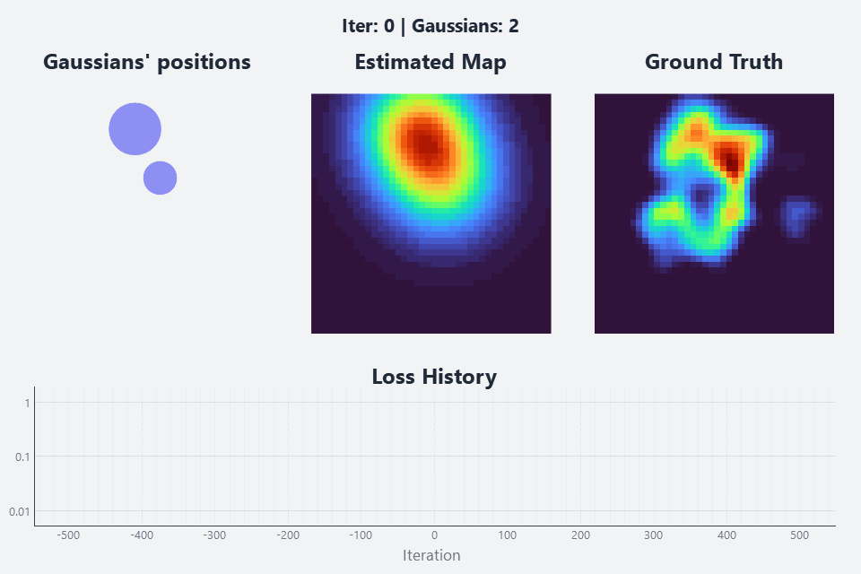
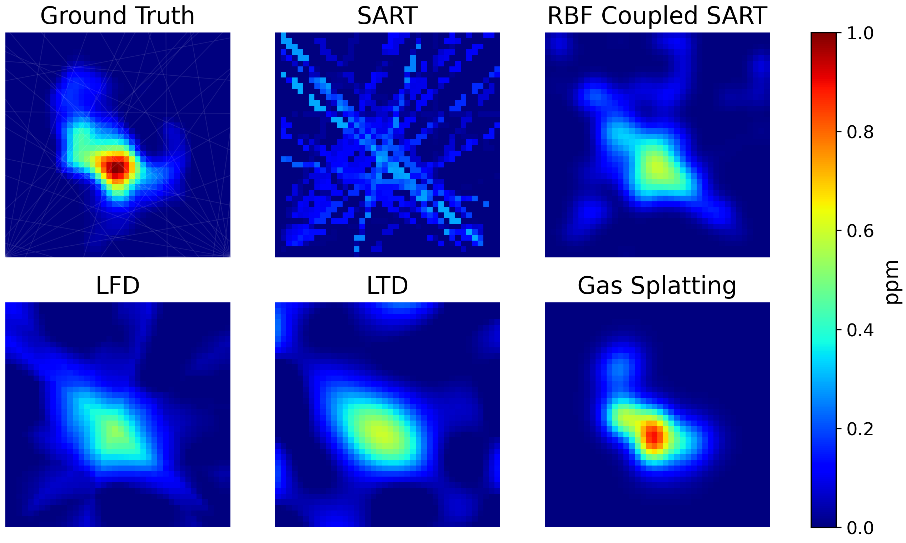

<h1 align="center">Gas Splatting</h1>

<p align="center">
  
  
</p>

<p align="center">
  
</p>
<p align="center"><i>Example of the Gas Splatting training evolution.</i></p>

## 📖 Overview

This repository contains the code for my Bachelor's Thesis (Trabajo de Fin de Grado - TFG). It presents a novel approach to gas distribution mapping by introducing **Gas Splatting**, a method based on Gaussian Splatting for 2D gas tomography using Tunable Diode Laser Absorption Spectroscopy (TDLAS) measurements.

The primary goal of this project is to accurately and efficiently reconstruct gas concentration maps by optimizing a set of 2D Gaussians through a differentiable pipeline.

## 📊 Performance Comparison

To evaluate the effectiveness of **Gas Splatting**, it is compared against traditional and state-of-the-art tomographic methods. The following results were obtained on a simulated 20x20m map with a grid resolution of 0.5m, using 40 TDLAS beams.

<p align="center">
  
</p>

| Method | RMSE ↓ | SSIM ↑ | Total Time (s) |
| :--- | :---: | :---: | :---: |
| SART | 0.1381 | 0.1481 | 1.19 |
| RBF Coupled SART | 0.0685 | 0.4623 | 1.30 |
| LFD | 0.0736 | 0.4788 | 1.24 |
| LTD | 0.0723 | 0.4760 | 1.23 |
| **Gas Splatting** | **0.0311** | **0.9045** | 3.51 |

*Note: While Gas Splatting requires more computational time, it achieves a significantly higher reconstruction quality (SSIM) and lower error (RMSE) compared to baseline methods.*

## 🗂️ Repository Structure

```bash
gas_splatting/
├── methods/            # Reconstruction method registry and runners
├── real_data/          # Real-world TDLAS sweep datasets (JSON)
├── scripts/            # Benchmarks, experiments, and plotting scripts
├── utils/              # Simulation, geometry, initialization, and math utilities
├── visualization/      # Visualization components and interactive tools
├── config.py           # simple_parsing configuration definitions
├── gs_model.py         # Gas Splatting model, densification logic 
├── main.py             # Main entry point (Sim -> Init -> Train)
└── trainer.py          # Optimization loop
```

## 🛠️ Installation

**1. Clone repository**
```bash
git clone https://github.com/aleevr04/gas_splatting.git
cd gas_splatting
```

**2. Create and activate a virtual environment**

The most convenient way to install dependencies is by creating a virtual environment. There are several tools for this purpose like `venv` or `conda`. A `venv` example is shown below:

```bash
# Linux / macOS
python3 -m venv .venv
source .venv/bin/activate

# Windows
python -m venv .venv
.venv\Scripts\activate
```

**3. Install PyTorch**

Since PyTorch is highly hardware-dependent (CPU or GPU), please install it by following the instructions from their [official website](https://pytorch.org/get-started/locally/). CPU-only example:

```bash
pip install torch torchvision --index-url https://download.pytorch.org/whl/cpu
```

**4. Install project dependencies**

```bash
pip install -r requirements.txt
```

<details>
<summary><h2>🚀 Usage</h2></summary>

### Standard Pipeline

To run the default simulation and training pipeline, simply execute the main script:

```bash
python main.py
```

This will generate simulation data (ground truth, beam geometry, and measurements), initialize model parameters, and start training.

### Experimental & Benchmarking Scripts

The `scripts/` directory contains various executable files designed to test, validate, and compare different aspects of the method:

* `make_scenarios.py`: Extracts the GADEN scenarios of the tuning and held-out sets (listed in `utils/scenario_sets.py`) from the VGR house archives into `data/scenarios`.

* `benchmark.py`: Runs Gas Splatting on a scenario set and reports, for every scenario, the normalized RMSE, recovered peak, mass error, gas inside obstacles, Gaussians and time, with a ground truth vs. reconstruction grid. Run it after any change to check that nothing got worse.

* `sweep.py`: One-at-a-time hyperparameter sweep on a scenario set. Each parameter is varied on its own and gets a plot of every metric against its value.

* `scale_invariance.py`: Checks that the reconstruction does not depend on the absolute concentration level, by repeating a run with the measurements multiplied by several factors.

* `noise_first.py`: Incremental run whose first batches only measure noise, checking that the concentration scale is raised when the gas is found.

* `compare_methods.py`: Compares Gas Splatting against state-of-the-art baselines. This script generates the visual reconstruction comparison grid shown in the performance section above.

* `densification_benchmark.py`: Runs benchmarks across multiple random seeds to compare the performance of a 3DGS-inspired adaptive densification strategy (split + clone) against our proposed approach, based exclusively on a split along the mayor axis.

* `densification_training.py`: Compares both densification strategies using a single seed, rendering the resulting gas maps alongside their loss functions and RMSE evolution plots.

* `split_c_factor.py`: Generates an error-evolution graph evaluating the impact of the splitting factor parameter (c) within our custom densification strategy.

* `fractal_distribution.py`: A standalone script to generate gas distribution maps using the same fractal algorithm used in simulation ground truths. Great for experimenting with different map sizes, grid resolutions, and random seeds.

* `grid_resolution.py`: Performs an scaling experiment evaluating how Gas Splatting holds up against baseline methods as the grid cell resolution increases.

* `num_beams.py`: Runs a scaling benchmark evaluating reconstruction accuracy as the number of available TDLAS measurement beams increases.

* `test_real_data.py`: Validates the proposed Gas Splatting method against real-world TDLAS experimental data.

### GADEN scenarios and hyperparameter tuning

Hyperparameters are tuned on the `tuning` set and the final values are checked on the `held_out` set, made of other houses:

```bash
python scripts/make_scenarios.py --vgr_dir ~/GADEN_files/scenarios   # once
python scripts/benchmark.py --set tuning                              # current configuration

# 1. Learning rates (current value x 1/4 ... x8)
python scripts/sweep.py --params concentration_lr pos_lr scale_lr
# 2. Densification and obstacle penalty
python scripts/sweep.py --params gradient_threshold prune_threshold densify_interval densify_until
python scripts/sweep.py --params injection_scale --values 0.1 0.25 0.5 1 2
python scripts/sweep.py --params obstacle_lambda --values 0 0.025 0.05 0.1 0.2 0.4
# 3. Stopping
python scripts/sweep.py --params iterations early_stopping_patience early_stopping_min_delta

python scripts/benchmark.py --set held_out                            # with the chosen values
```

After each stage, the chosen values are set in `config.py` (or passed on the command line) before sweeping the next one. Plots go to `plots/` and results to `results/`. Runs are parallel (`--workers`), so the times they report are only indicative; use `--workers 1` to measure them.

### Visualization

The `visualization/` directory contains components used to display training progress and standalone visualization tools:

* `visualization/live_visualizer.py`: Reusable live training visualizer instantiated by the trainer.

* `visualization/split_visualizer.py`: Standalone interactive tool for inspecting Gaussian splitting.

</details>


<details>
<summary><h2>⚙️ Configuration and CLI Options</h2></summary>

This project uses `simple_parsing` to dynamically handle configuration parameters from the command line. You can customize almost any aspect of the simulation, initialization, training, and densification processes.

To see a full list of available options for a given script, run:

```bash
python [script] --help
```

### Examples

Run a custom simulation with 50 beams and a maximum of 2000 training iterations:

```bash
python main.py --num_beams 50 --iterations 2000
```

Evaluate grid resolution performance across 20 random seeds using a 0.5m cell size:

```bash
python scripts/grid_resolution.py --num_seeds 20 --cell_size 0.5
```

Train the model using custom learning rates and enable real-time visualization:

```bash
python main.py --pos_lr 0.005 --concentration_lr 0.002 --live_vis
```

> ⚠️ Important Note: Because configuration classes are shared across the entire project, some CLI options might not be applicable or will have no effect depending on the specific script you are executing. For example, changing the seed will not affect experiment scripts desinged to test different seeds.

</details>

## 📜 Acknowledgements and License

This project introduces custom implementations and novel features developed specifically for **Gas Splatting**. However, the core architecture and some of its utilities are deeply inspired by and built upon the open-source repository [r2_gaussian](https://github.com/ruyi-zha/r2_gaussian), which in turn is a derivative of the original 3D Gaussian Splatting implementation by Inria and MPII.

Because this repository contains derivative work, it is distributed under the identical **Gaussian-Splatting License**. 

* **The software is provided strictly for non-commercial, research, and evaluation purposes.**
* Any commercial use requires prior and explicit consent from the original licensors (Inria/MPII).

For more details, please refer to the `LICENSE` file included in this repository.